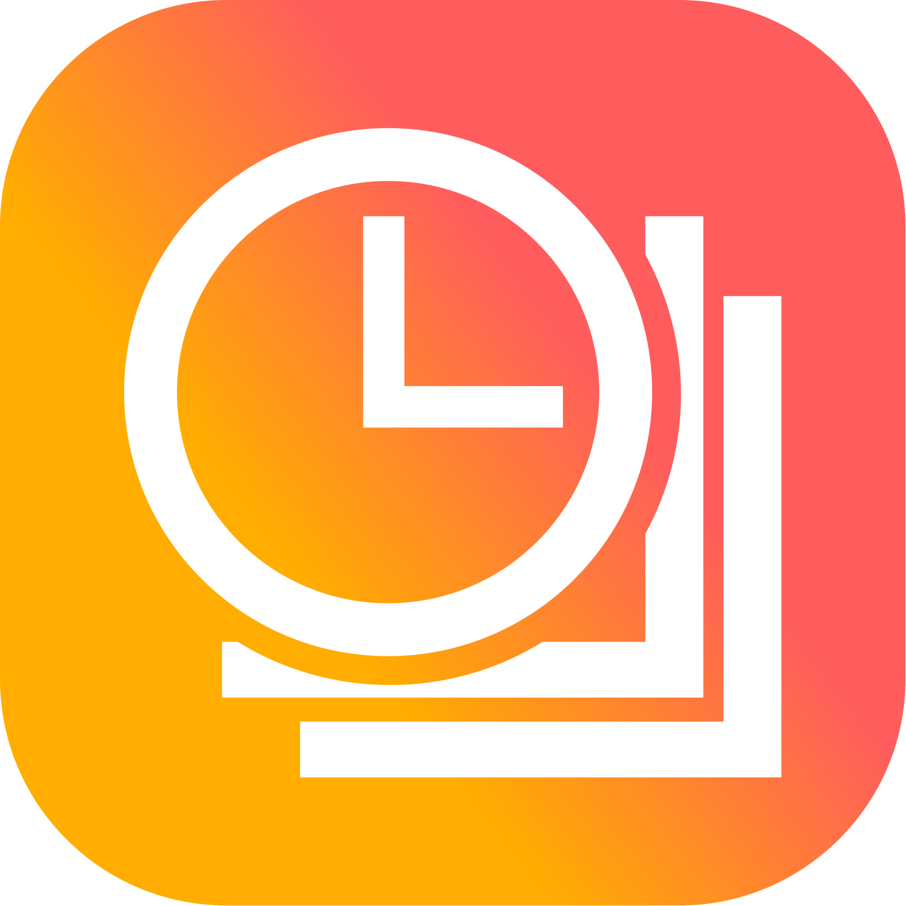
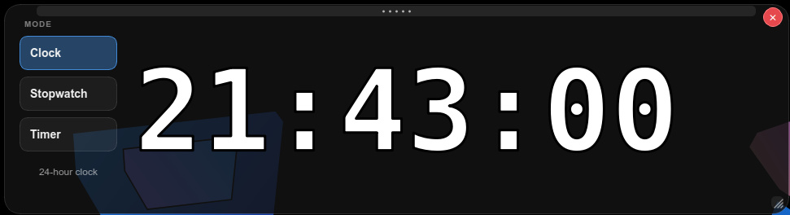
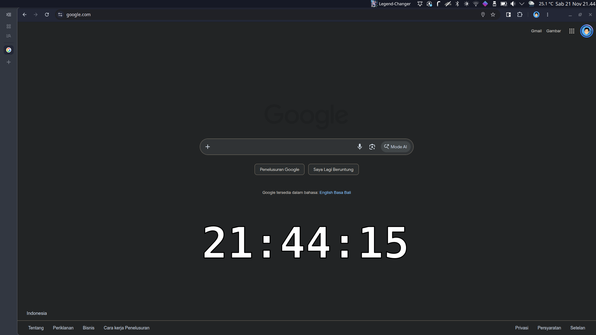
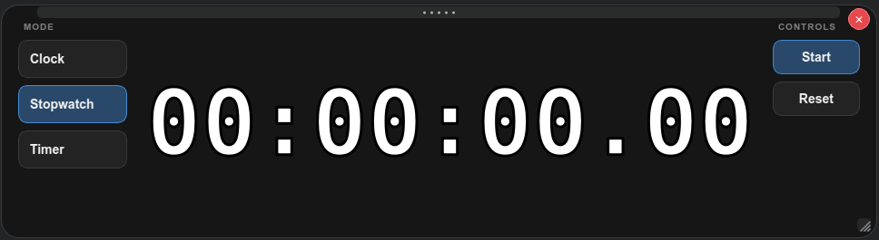
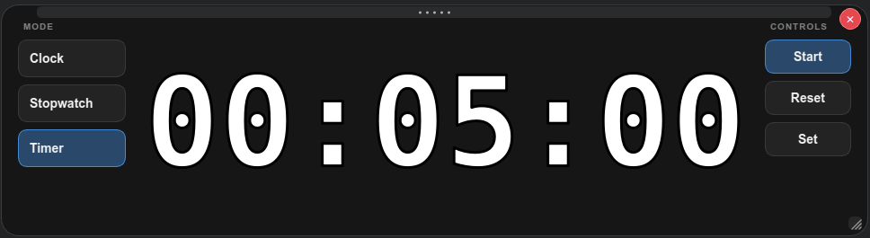
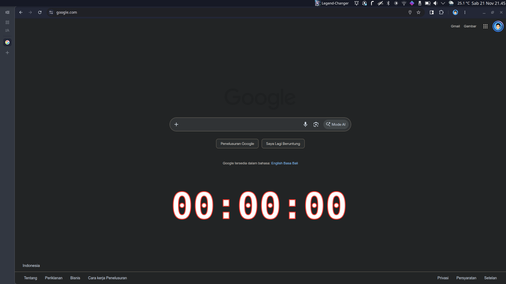

<p align="center">
  
</p>
<h1 align="center">Time Overlay</h1>
<p align="center">A frameless, always-on-top clock, stopwatch, and countdown timer for Windows and Linux.</p>

Time Overlay keeps the time in sight without taking over your desktop. It shows large white time with a black outline. Hover over it to reveal the controls; move the cursor away and only the time remains.

## What you can do

- Run a **clock**, **stopwatch**, and **countdown timer** in one small overlay.
- Hover to show the mode and control panels; leave the window for a clean "ghost mode".
- Drag the top bar to move the window and use the bottom-right grip to resize it.
- Keep the overlay above other application on Windows and Linux.

## Screenshots

<p align="center">
  
</p>
<p align="center"><em>Clock mode, with the mode and control panels revealed.</em></p>

<p align="center">
  
</p>
<p align="center"><em>Ghost mode over a browser: only the outlined time remains.</em></p>

<details>
<summary>More screenshots</summary>

<p align="center">
  <br>
  <em>Stopwatch</em>
</p>
<p align="center">
  <br>
  <em>Timer</em>
</p>
<p align="center">
  <br>
  <em>Timer finished over a browser.</em>
</p>

</details>

## Download and run

Get the latest build from the **[GitHub Releases page](https://github.com/cptodix/time_overlay/releases/latest)**.

The release files are portable: you do not need Python installed.

### Windows

1. Download `TimeOverlay-<version>-windows-x64.exe`.
2. Double-click the file.
3. If Windows SmartScreen warns, choose **More info** → **Run anyway**. The EXE is not code-signed.

There is no installer and no console window. The overlay appears near the bottom of the screen.

### Linux

1. Download `TimeOverlay-<version>-x86_64.AppImage` (or `aarch64` on ARM).
2. Make it executable and run it:

   ```bash
   chmod +x TimeOverlay-<version>-x86_64.AppImage
   ./TimeOverlay-<version>-x86_64.AppImage
   ```

3. If FUSE 2 is not installed, run it in extract-and-run mode:

   ```bash
   APPIMAGE_EXTRACT_AND_RUN=1 ./TimeOverlay-<version>-x86_64.AppImage
   ```

The AppImage can be moved anywhere. Nothing is installed into the system.

### First launch

- The overlay starts in **Clock** mode near the bottom of the primary screen.
- Hover over it to show the controls.
- Only one copy runs at a time. Starting a second copy shows an "already running" notice.
- Settings are stored locally with Qt's `QSettings`; no account or network connection is used.

## Using the overlay

| Mode | Controls |
| --- | --- |
| **Clock** | `Clock`, `Stopwatch`, `Timer`, and the 12/24-hour toggle. The right column is blank. |
| **Stopwatch** | `Start`/`Pause`, `Reset`. Reset zeroes the time but keeps a running stopwatch running. |
| **Timer** | `Start`/`Pause`, `Reset`, `Set`. Reset is disabled while the timer is running; pause first. |

- **Hover** over the window to reveal the panel contents, the drag and resize grips, and the red X.
- **Move the cursor away** to enter ghost mode: the panels and dark background disappear, leaving only the outlined time.
- **Drag** the centered bar across the top to move the window.
- **Resize** with the grip in the bottom-right corner.
- **Right-click** for the menu: center on screen, switch 12/24-hour clock, or quit.
- **Click the red X** at the top right to exit.

### Timer behavior

- `Set` opens a modal HH:MM:SS picker with 1/5/10/15/25/45-minute presets.
- The `Set` button is disabled for a zero-length timer.
- On reaching zero the timer stops, flashes the outline red/white, and beeps once per second.
- The beep repeats until you click anywhere, including Start/Pause, Reset, Set, a mode button, the 12/24-hour toggle, or the red X.
- `Reset` is only available while the timer is paused or finished.

## Known issues

These are the current user-facing limits. Full details, workarounds, risks, and future work are in **[KNOWN_ISSUES.md](KNOWN_ISSUES.md)**.

- **Fullscreen presentations can cover the overlay.** Exclusive fullscreen takes over the display and no normal app can draw above it. Use borderless/windowed fullscreen or a second display. On X11, try `TIME_OVERLAY_X11_DOCK=1`.
- **Native Wayland always-on-top is compositor-dependent.** The app defaults to XWayland when `DISPLAY` is available. Set `TIME_OVERLAY_NATIVE_WAYLAND=1` to stay on native Wayland.
- **The Windows EXE is unsigned**, so SmartScreen may warn.
- **The AppImage needs FUSE 2**, or start it with `APPIMAGE_EXTRACT_AND_RUN=1`.
- **The timer beep uses the system bell**, which can be silent if the desktop bell is disabled.
- **Mode, timer, and stopwatch state are not saved** across restarts.
- **Long times cap at `99:59:59`.**

## For developers and contributors

### Requirements

- Python **3.10+**
- PyQt6 **6.6+**
- Windows 10/11, or a Linux desktop with a compositor (X11 or Wayland)

The release binaries do not need Python or PyQt6 installed.

### Run from source

```bash
python3 -m venv .venv
source .venv/bin/activate          # Windows: .venv\Scripts\activate
python -m pip install -r requirements.txt
python main.py
```

You can also run the package directly:

```bash
python -m time_overlay
```

### Platform support

- **Windows:** native topmost is reasserted with `SetWindowPos(HWND_TOPMOST)` every 2 seconds.
- **Linux X11:** utility/dock hints plus a 2-second restack. Set `TIME_OVERLAY_X11_DOCK=1` for window managers that keep fullscreen windows above normal topmost clients.
- **Linux Wayland:** the app defaults to XWayland when `DISPLAY` is available, so the X11 above hints can apply. Native Wayland topmost is controlled by the compositor; set `TIME_OVERLAY_NATIVE_WAYLAND=1` to keep native Wayland.

See [KNOWN_ISSUES.md](KNOWN_ISSUES.md) for the fullscreen-presentation limitation and the remaining platform work.

### Packaging

#### Windows — portable single-file EXE

The app icon source is `packaging/time_overlay_icon.svg`. The build script renders it to PNG/ICO, then runs PyInstaller:

```bat
packaging\build_windows.bat
```

Equivalent manual commands:

```bat
python -m pip install -r requirements-build.txt
python packaging\make_icon.py build\time-overlay.png --ico build\time-overlay.ico --svg packaging\time_overlay_icon.svg
python -m PyInstaller --noconfirm --clean --onefile --noconsole ^
  --name TimeOverlay --icon build\time-overlay.ico ^
  --add-data "packaging\time_overlay_icon.svg;packaging" main.py
```

Output: `dist\TimeOverlay.exe` — a portable single-file executable with no installer and no console window.

#### Linux — standalone AppImage

```bash
chmod +x packaging/build_linux.sh packaging/AppRun
./packaging/build_linux.sh
```

The script:

1. Runs PyInstaller with `--onefile`.
2. Creates an AppDir with `AppRun`, a `.desktop` file, the scalable SVG app icon, and a generated 256×256 PNG fallback.
3. Downloads pinned `appimagetool` 1.9.1 and type-2 runtime 20251108 (cached in `build/`), verifies their SHA256, and produces `dist/TimeOverlay-x86_64.AppImage` (or `aarch64`).

Build dependencies: Python 3, `curl`, and the usual Qt runtime libraries. `APPIMAGE_EXTRACT_AND_RUN=1` is used so FUSE is **not** required on the build machine.

Run the result:

```bash
chmod +x dist/TimeOverlay-x86_64.AppImage
./dist/TimeOverlay-x86_64.AppImage
```

If FUSE 2 is not installed on the target machine, use the AppImage's extract-and-run mode:

```bash
APPIMAGE_EXTRACT_AND_RUN=1 ./dist/TimeOverlay-x86_64.AppImage
```

### Automated releases

The `Release` workflow is triggered manually and creates the tag for you. Choose a bump type (`patch`, `minor`, or `major`); it reads the latest `vX.Y.Z` tag, computes the next version, runs the tests, builds both artifacts, creates the new tag, and publishes a GitHub Release for it. It only runs on the repository's default branch. The app version is stamped from the new tag before the builds, and both artifacts get a short start-up smoke test before they are published.

From the GitHub UI: **Actions → Release → Run workflow**, choose `patch` / `minor` / `major`.

Or with the GitHub CLI:

```bash
gh workflow run release.yml -f release_type=patch
```

The tag is created only after the tests and both builds succeed, and it points at the commit the workflow was dispatched on. If no previous tag exists, the first release starts from `v0.0.0` and increments the chosen part. Concurrent release runs are serialized with a `concurrency` group so the version cannot race.

If publishing fails after the tag has been created, re-run the failed `release` job: the tag is reused when it already points at the same commit, so the version is not bumped twice.

Release assets (example for `v1.2.3`):

- `TimeOverlay-v1.2.3-windows-x64.exe`
- `TimeOverlay-v1.2.3-x86_64.AppImage`

The Linux artifact is built on Ubuntu 22.04 for broad glibc compatibility.

### Tests

```bash
QT_QPA_PLATFORM=offscreen python3 -m unittest discover -s tests -v
```

- `tests/test_core.py` covers the Qt-free stopwatch/countdown state machines and formatting.
- `tests/test_ui.py` is a headless smoke test for window flags, ghost-mode visibility, mode switching, timer controls, clock format, responsive font scaling, geometry clamping, the red close button, the repeating finish beep stopped by a click, the drag/resize grips, the set dialog (including a pixel check that field values are painted white, a deletion check, and keyboard/wheel behavior), and the app icon.
- `tests/test_app.py` checks the single-instance lock and the Wayland/XWayland platform selection.

The suite currently contains **51 tests**.

### Project layout

```text
main.py                       PyInstaller/direct entry point
HANDOVER.md                   Maintainer handover, architecture and release context
KNOWN_ISSUES.md               Known limits, workarounds, risks and future work
AGENTS.md                     Rules for automated agents working in the repo
Screenshots/                  User-facing screenshots used by this README
time_overlay/
  app.py                      QApplication bootstrap, platform choice, single instance
  window.py                   Overlay window, modes, hover, drag, beeping
  outlined_label.py           QPainterPath outlined-text widget
  core.py                     Stopwatch, CountdownTimer, formatters
  dialogs.py                  HH:MM:SS set dialog with presets
  widgets.py                  Drag/resize grips and the painted time field
  platform_hints.py           Windows topmost + Linux X11/Wayland hints
  theme.py                    Qt stylesheets and dark palette
packaging/
  build_windows.bat           PyInstaller one-file build
  build_linux.sh              AppImage build
  make_icon.py                SVG-to-PNG/ICO icon renderer
  time_overlay_icon.svg       Source app icon
  AppRun, time-overlay.desktop
tests/
  test_core.py                Core state machines and formatting
  test_ui.py                  Headless UI/behaviour tests
  test_app.py                 Bootstrap and platform-selection tests
.github/workflows/release.yml Manual version-bump Windows + Linux release
```

### Maintainer handover

See [HANDOVER.md](HANDOVER.md) for architecture, invariants, packaging and release-workflow details, known gaps, troubleshooting, and a first-day checklist.

### License

GNU General Public License v3.0 or later. See [LICENSE](LICENSE).
